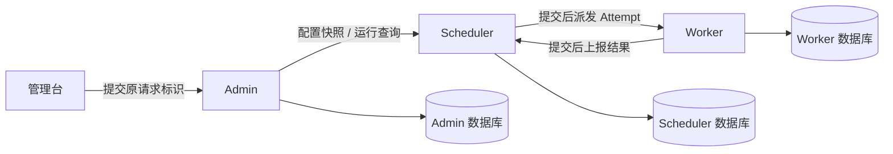

# 手动执行协议 v1

本协议记录手动触发、执行快照和结果上报的 HTTP 契约。默认派发已切换为 [RabbitMQ v1 事件与事务 Outbox](reliable-dispatch.md)，本文的 Worker HTTP 派发作为显式兼容通道。Admin 拥有 Job 配置，Scheduler 拥有 Run/Attempt，Worker 的独立数据库只保存执行去重与待上报结果。所有服务按业务能力分包，不引用其他服务的 Java 模块或数据表。

## 接口

| 调用方 | 方法与路径 | 行为 |
| --- | --- | --- |
| 浏览器 → Admin | POST /api/v1/runs/insert | jobId、configVersion、requestKey（UUID）；创建逻辑 Run |
| 浏览器 → Admin | GET /api/v1/runs/select?jobId=&page=&pageSize= | 当前 Job 的运行历史 |
| 浏览器 → Admin | GET /api/v1/runs/selectById?id= | Run、完整配置快照、Attempt 历史 |
| 浏览器 → Admin | GET /api/v1/runs/selectByRequestKey?requestKey= | 提交超时后确认原请求 |
| Admin → Scheduler | POST /internal/v1/runs/insert | requestKey 与数据库权威配置快照 |
| Admin → Scheduler | GET /internal/v1/runs/select、selectById、selectByRequestKey | 查询 Scheduler 权威运行历史 |
| Scheduler → Worker | POST /internal/v1/executions/insert | attemptId、runId、attemptNumber、leaseVersion、expiresAt、snapshot |
| Scheduler 诊断 → Worker | GET /internal/v1/executions/selectById?attemptId= | 读取本地接收状态；不作为全局权威运行状态 |
| Worker → Scheduler | POST /internal/v1/attempts/updateResult | attemptId、runId、leaseVersion、status、resultCode、message、retryable、workerId、sessionId |
| Worker → Scheduler | POST /internal/v1/attempts/updateLease | attemptId、runId、leaseVersion、workerId、sessionId；领取/续租，返回短租约及硬截止，详见 [执行租约](execution-leases.md) |

公开接口沿用 Admin 的 ApiResponse，内部成功响应直接返回版本化 JSON DTO。查询 GET、状态变更 POST。内部请求使用 X-Taskflow-Token，控制、派发、结果上报使用三份独立随机密钥；空密钥拒绝请求。实际密钥只放忽略的本机 YAML 或环境变量，不发送给浏览器。内部地址固定来自配置，Worker 不接受调用方传入的回调 URL。

## 语义

- Job 是可修改配置；Run 是一次手动运行；Attempt 是一次尝试。人工再次执行使用新 requestKey、新 Run；自动业务重试保留 Run、新增 Attempt。
- 同 requestKey 的相同配置快照只产生一个 Run；同 key 不同任务/版本/快照返回 409。Admin 先按 requestKey 查询已接收结果，再读取 Job，避免原请求重试时使用修改后的配置。新请求比较数据库 configVersion，不经过展示缓存。
- 手动执行可用于启用或停用的配置；enabled 只约束未来自动调度，不代表禁止手动调试。Cron 自动扫描已实现，见 [自动调度](automatic-scheduling.md)。
- 创建 Run 和首次 Attempt 在 Scheduler 本地事务中一起提交；提交成功才扫描派发，事务内不调用 Worker。HTTP 接收成功不代表执行成功。未派发工作和重试时间保存在数据库，重启后继续扫描。
- 每次派发携带相同 attemptId 与租约版本。Worker 先持久化 Inbox，再异步执行。重复派发返回原接收记录；相同 attemptId 的不同内容返回 409。一个 Worker 数据库对应一个执行进程，不供多个 Worker 进程共同抢占。
- 派发资格不满足时，按 `taskflow.dispatch.node-recheck-delay`（默认 2s）持久化推迟资格检查时间，避免不可派发任务占满扫描批次。HTTP 和 MQ 准备共用此规则，MQ Relay 也对待发布记录执行延后检查。等待不计入派发/发布次数，不创建新 Attempt；已存在的执行租约保持原到期时间，过期仍按原规则终结。节点恢复后按已保存的下次检查时间恢复原工作。验证见 [扫描公平性](dispatch-fairness-verification.md)。
- Worker 使用有上限的执行线程和待执行容量。超时会中断 Handler，执行槽位直到 Handler 实际退出才释放。内置 Handler 支持成功、失败、可控耗时、首次失败；业务 Handler 必须自行保证外部副作用幂等。
- Worker 将终态和待上报标记一起持久化，再由扫描器有限重报。Worker 重启后保留 ACCEPTED 工作；之前 RUNNING 的执行转为失败/WORKER_RESTARTED，不盲目重做未知外部副作用。
- Worker 对同一份已完成结果有限重试本地保存，默认总共 5 次、间隔 500ms，不重新调用 Handler；原执行槽位保留到保存结束。提交成功但确认丢失时核对相同终态，冲突不覆盖。耗尽或中断记录可按 Run / Attempt 定位的错误；数据库可能仍为 RUNNING，重启继续表示副作用未知。线程池拒绝已领取任务时以 EXECUTOR_REJECTED 收尾。配置、诊断和验证见 [结果保存恢复](worker-result-recovery.md)。
- Worker 派发扫描与结果上报使用两个独立的单线程调度器，节点心跳仍使用独立调度器。结果上报使用 `workerReportScheduler`（线程名前缀 `taskflow-report-`），采用 fixedDelay，上一轮结束后再等待扫描间隔启动下一轮，不并发执行多轮上报；派发与上报均受 `taskflow.execution.scanning-enabled` 控制。
- 每轮上报从进入 `reportPending()` 时计算 `taskflow.execution.report-budget` 截止时间（默认 2s，必须大于 0 且不超过 30s）。每条记录在 `reportClaim` 之前检查预算，到期则结束本轮，剩余记录不领取、不发送、不消耗重报次数；下轮按原有到期条件继续处理。预算仅在记录之间生效，单条在途请求不会被中断，预算耗尽只记录一次 debug 日志。
- 结果上报仍为 at-least-once 语义：先持久化 claim，再在事务外发送 HTTP，收到确认才标记已上报；响应丢失时可能重发，Scheduler 幂等接收。有限重报次数与恢复门控保持不变，不承诺无限重试或必然送达。
- Scheduler 终态写入检查 attemptId、当前 Attempt、目标 Worker、已领取执行会话、状态、leaseVersion 和未过期租约。重复相同终态幂等确认，不接受冲突终态。租约过期不代表旧 Worker 已物理停止。
- Attempt 绑定的 Worker 在调用 Handler 前领取短租约，绑定 workerId 与独立执行会话；后续独立续租，不更改派发消息或 leaseVersion，不延长硬截止。Handler 接收快照与 ExecutionContext；业务幂等以 runId 为稳定范围，attemptId 用于尝试去重，leaseVersion 仅作为同一 Run 内的 fencing 版本。超时、取消、保存及上报有效期见 [执行租约](execution-leases.md)。
- Scheduler 的状态变更事务统一按 Run → Attempt 加行锁；MQ 确认需要访问 Outbox 时在两者之后加锁。首次普通读取只定位不可变 runId，等待 Run 锁后通过 `SELECT ... FOR UPDATE` 读取 Attempt 当前状态，不使用旧的 REPEATABLE READ 快照作状态决策。HTTP 请求与 MQ 发布仍在 SQL 事务外。
- HTTP 接收确认和 MQ 发布确认共用状态转换保护：必须匹配当前 Attempt、消息租约版本和有效期；Attempt SQL 更新成功才推进 Run，Run SQL 同时检查原状态和当前 Attempt，终态不允许回退。终态写入、创建重试与 Outbox 变更也检查影响行数，任一转换失败则回滚整个本地事务。本地确认失败不归类为 Worker 拒绝；保留原 Attempt，由既有扫描及租约机制恢复。此修复不自动重写历史异常记录，验证见 [状态并发修复](run-state-concurrency-verification.md)。
- 明确的 HANDLER_FAILED 可按快照 maxAttempts 和 retryIntervalSeconds 有限重试；不确定派发失败不立即创建业务重试；已报告的执行超时和 Worker 重启保持原非重试语义。Scheduler 观察到租约失效时，默认按快照上限新增 Attempt，并重新选择节点，可用 `TASKFLOW_RETRY_ON_LEASE_LOSS=false` 关闭。业务失败重试必须考虑副作用幂等。
- Run 状态为 READY、RUNNING、RETRY_WAIT、SUCCEEDED、FAILED；Attempt 为 READY、DISPATCHING、RUNNING、SUCCEEDED、FAILED、TIMED_OUT。终态不可被迟到结果覆盖。

## 超时与故障

连接/请求超时、扫描间隔、有限派发次数、结果重报次数、执行容量和租约宽限统一放各服务 YAML。Admin 不在数据库事务内等待 Scheduler；Scheduler 不在数据库事务内等待 Worker；Worker 不在数据库事务内等待结果回调。超时不等于请求未接收：浏览器保留 requestKey 重试原请求，Scheduler 对不确定派发复用 attemptId。

HTTP 链路使用静态地址与密钥，数据库是权威来源。默认任务派发已接入 RabbitMQ，Broker 权限限定发布方与消费方；显式 HTTP 模式继续使用原派发密钥。[Worker 注册/心跳](worker-nodes.md) 已实现，MQ 首次派发按能力和负载选择节点、持久化目标及路由，发布重试只检查原目标；HTTP 继续检查固定目标在线和能力/路由，节点 generation 不代替执行租约。Worker 执行续租和 Handler 上下文已实现，协议与有效性边界见 [执行租约](execution-leases.md)。MQ 动态选址和租约失效后的有限跨节点重试见 [水平扩展](worker-horizontal-scaling.md)；不提供同一 Attempt 跨 Inbox 接管，不承诺外部副作用恰好一次。前期 HTTP 验收记录保留在 execution-verification.md，后续记录见 [MQ 验证](mq-verification.md) 与 [节点验证](worker-nodes-verification.md)。

## YAML 配置

各服务连接参数、执行策略和限额统一位于各自 application.yml；测试使用 application-test.yml。Scheduler / Worker 从 properties 迁移为 YAML，不保留同目录双主配置。

| 环境变量 | 消费方 | 用途 |
| --- | --- | --- |
| TASKFLOW_SCHEDULER_URL | Admin、Worker | Scheduler HTTP 地址 |
| TASKFLOW_WORKER_URL | Scheduler | Worker HTTP 地址 |
| TASKFLOW_CONTROL_TOKEN | Admin、Scheduler | 创建 Run 与查询运行历史的身份 |
| TASKFLOW_DISPATCH_TOKEN | Scheduler、Worker | Worker 派发与诊断身份 |
| TASKFLOW_REPORT_TOKEN | Worker、Scheduler | 结果上报身份 |
| TASKFLOW_REPORT_BUDGET | Worker | 每轮结果上报预算，默认 2s，范围 (0, 30s] |
| TASKFLOW_RESULT_SAVE_MAX_ATTEMPTS | Worker | 本地结果保存总次数，默认 5，范围 1–10，与 HTTP 重报独立 |
| TASKFLOW_RESULT_SAVE_RETRY_DELAY | Worker | 本地结果保存重试间隔，默认 500ms，范围 1ms–5s |
| TASKFLOW_SCHEDULER_DB_URL / USERNAME / PASSWORD | Scheduler | 独立数据库连接；每项均带 TASKFLOW_SCHEDULER_DB_ 前缀 |
| TASKFLOW_WORKER_DB_URL / USERNAME / PASSWORD | Worker | 独立数据库连接；每项均带 TASKFLOW_WORKER_DB_ 前缀 |

连接超时默认 2 秒、HTTP 请求超时 3 秒；扫描间隔 500ms。Scheduler 派发总尝试次数默认 5，传输重试间隔 2 秒，租约宽限 10 秒；业务重试从快照读取。Worker 并行执行槽位默认 4、待处理上限 32，结果重报总次数 30、间隔 2 秒。Java 不硬编码服务地址、数据库参数或密钥。

单轮上报的网络等待按预算 B 加最后一条在途请求的最大耗时 T 估算，上界为 B + T；若单条请求最多 3s，默认约为 2s + 3s = 5s，而非 100 × 3s = 300s。当前 Feign 分别使用 connect-timeout 作为连接超时、request-timeout 作为读取超时；将这两个阶段的超时相加，保守估算为 2s + (2s + 3s) = 7s。此估算另需加数据库访问、DNS、本地处理与线程调度开销；读取超时也不等于整个 HTTP 调用的硬截止时间，因此不是整个方法耗时的硬实时保证。fixedDelay 的 500ms 是轮次之间的等待，不计入本轮耗时。上报等待不会占用派发扫描线程。
