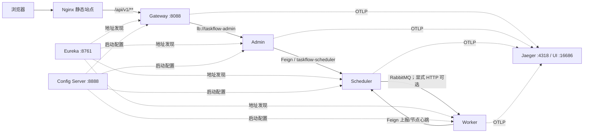

# 微服务技术栈与网关

更新：2026-10-27。业务服务独立部署、数据归属明确是架构基础；随着服务数量、入口和故障处理需求增加，本次补齐注册发现、集中配置、网关和可观测性。六个应用各自打包，不通过 Maven 引用其他应用。

## 组件与选择

| 能力 | 实现 | 边界 |
| --- | --- | --- |
| 公共入口 | Spring Cloud Gateway Server WebFlux，Netty，8088 | 仅转发 `/api/v1/**` 到 `lb://taskflow-admin` |
| 注册发现 | Eureka Server，8761；四个应用客户端 | 发现网络实例，不维护任务或执行状态 |
| 配置中心 | Spring Cloud Config Server，8888，native/Git | 存放非秘密治理策略，默认启动时加载 |
| 内部 HTTP | OpenFeign + Spring Cloud LoadBalancer | 有限连接/读取超时，显式内部鉴权，无自动重放 |
| 熔断 | Spring Cloud CircuitBreaker + Resilience4j | 下游异常快速失败，返回真实错误 |
| 链路 | Micrometer Tracing + OpenTelemetry + OTLP | W3C traceparent 传播、日志 trace/span、HTTP 导出 |
| 收集展示 | Jaeger 2.22.0 Compose | 可选，当前机器未运行 Docker，未宣称 UI 已验收 |

Java 21、Spring Boot 4.1.1 保持不变，父 POM 通过 Spring Cloud 2025.1.4 BOM 管理版本。依据 [Spring Cloud 版本兼容表](https://spring.io/projects/spring-cloud/)，2025.1 系列从 2025.1.2 支持 Boot 4.1。Feign 处于功能完备维护阶段，本次按用户指定需求采用；客户端封装在各服务 remote 包，不把协议或业务实体集中到 common 模块。



## 网关入口约束

- Nginx 的 API 上游为 Gateway；Gateway 不承担 Handler、SQL 或调度逻辑，仅访问自己拥有的 Redis 限流键，不访问 Admin 的会话或业务缓存。
- 显式路由 `/api/v1/**`，保留动作路径和响应格式，关闭自动按服务名暴露路由；没有 `/taskflow-worker/**` 等隐式入口。
- 拒绝 `/internal/**`、`/eureka/**`、配置中心路径及非健康 Actuator；拒绝含编码斜线、点路径、反斜线、分号等歧义路径。内部 token 在入口删除，浏览器不能借网关携带控制密钥。
- 校验/生成 `X-Request-Id`，响应包含请求关联信息和有效时的 `X-Trace-Id`。请求体限制 128KB，连接超时 2 秒、响应超时 8 秒，网关熔断时间限制 9 秒。
- 下游不可用/熔断返回 503、`GATEWAY_UNAVAILABLE`；没有模拟成功。未配置任何 Retry 过滤器，POST 不因入口故障自动重复提交。
- `/actuator/health` 及 readiness/liveness 用于进程探测，其余管理端点不经网关开放。

已实现独立 Keycloak 登录、Gateway/Admin 双重 JWT 校验、Admin 角色权限与 Redis JWT 会话（有效请求滑动续期 30 分钟）、Gateway Redis 用户限流及 Nginx IP 粗限流。公开登录配置允许匿名读取，其他业务接口要求有效身份和会话，未配置的路径/方法默认拒绝。issuer 缺失拒绝启动，限流或会话 Redis 故障返回 503。首次配置和权限矩阵见 [登录与入口安全](access-security.md)。本地模板尚未部署公网 TLS，生产必须提供 HTTPS。默认所有 Java 服务绑定回环地址；跨主机部署必须配置各服务 `TASKFLOW_*_BIND_ADDRESS`、可达的 `TASKFLOW_INSTANCE_HOST`，并通过网络访问控制仅开放必要入口。Basic 凭据跨主机传输应置于 TLS/可信内网，不能将内部端口直接发布公网。

## 配置与启动

从仓库根目录运行，先有各业务服务自己的 MySQL/Redis/内部密钥配置，并完成根构建。运行派发默认 RabbitMQ，需先启动集群；集群未搭建时按 README 显式使用 HTTP，并在 Scheduler/Worker 本机 YAML 关闭 Rabbit 健康探测。平台服务不会替代这些业务前置设施：

```powershell
.\mvnw.cmd verify
.\tools\prepare-platform.ps1
.\tools\prepare-node-identity.ps1
.\tools\services.ps1 -Action start
.\tools\services.ps1 -Action status
```

`prepare-platform` 生成独立随机的注册中心/配置中心凭据，保存在被忽略的 `config/taskflow-platform-local.yml` 和 `deploy/platform/.env`，不覆盖已有本机凭据。两个 Server 未提供至少 24 位密码时拒绝启动。Eureka API 使用 Basic 认证，Config Server 仅允许认证读取；匿名仅能查看简要健康状态。

`services.ps1` 按 Registry → Config Server → Scheduler → Worker → Admin → Gateway 启动，四个应用启用 cloud profile。已有运行进程不会自动替换；升级时需显式 restart 对应服务。脚本只管理其记录且身份匹配的 PID，启动/重启不会自动迁移或切换 Nginx 发行包。

已有旧版进程需在核对本机配置和数据库迁移后执行 `services.ps1 -Action restart`，再更新 Nginx 发行包；单独 start 会保留旧进程，旧版未注册 Eureka 时 Gateway 不会通过静态地址绕过发现。业务服务启动时仍会执行其 Flyway 迁移，平台脚本自身不操作业务表。

| 模式 | 注册发现与配置 | 用途 |
| --- | --- | --- |
| `cloud` | 强制 Config Server 导入，Eureka 注册/查询，服务名 Feign/LB | 集成环境及后续部署 |
| 直接启动默认配置 | Eureka/Config 关闭，原内部 URL；Gateway local 使用 SimpleDiscoveryClient | 独立开发，保留既有工作流 |
| `test` / 隔离脚本 | H2、独立密钥和端口；按脚本选择真实平台 | 不写业务 MySQL |

`services.ps1 -Standalone` 可启动直连模式。单独 Maven 启动 cloud：

```powershell
.\mvnw.cmd -pl taskflow-admin spring-boot:run "-Dspring-boot.run.profiles=cloud"
```

| 环境变量 | 默认/意义 |
| --- | --- |
| `TASKFLOW_GATEWAY_PORT` | 8088 |
| `TASKFLOW_REGISTRY_PORT` / `TASKFLOW_CONFIG_PORT` | 8761 / 8888 |
| `TASKFLOW_CONFIG_SERVER_URL` | `http://localhost:8888`，启动引导地址 |
| `TASKFLOW_CONFIG_USERNAME` / `TASKFLOW_CONFIG_PASSWORD` | 可覆盖本机配置中心凭据 |
| `TASKFLOW_REGISTRY_URL` | 带认证的 Eureka `/eureka/` 地址；本机由准备脚本生成 |
| `TASKFLOW_INSTANCE_HOST` / `TASKFLOW_INSTANCE_ID` | 注册的可达主机名 / 实例标识，默认 localhost / 随机 UUID |
| `TASKFLOW_ADMIN_URL` | Gateway local 模式的 Admin 地址，默认 localhost:8080 |
| `TASKFLOW_TRACING_EXPORT_ENABLED` | 默认 false，显式 true 导出 OTLP |
| `TASKFLOW_OTLP_ENDPOINT` | 默认 `http://localhost:4318/v1/traces` |
| `TASKFLOW_TRACING_SAMPLING` | 默认 0.1，验收设置 1.0 |

Config native 默认读取 `deploy/config-repo`。`application.yml` 提供默认引导配置，`application-cloud.yml` 提供统一熔断/重试策略和配置修订标识。凭据、数据库地址和内部 token 不进入此目录；中心地址及认证仍属于进程启动引导。Git 后端使用 Config Server 的 git profile，设置 `TASKFLOW_CONFIG_GIT_URI`，可选用户名/密码和分支，具体变量见 `application-git.yml`。

配置读取失败时 cloud 应用启动失败；运行中不逐请求访问配置中心，短时配置中心故障不影响已加载策略。默认修改后滚动重启应用生效，本次没有开放 refresh/bus/env 写端点或承诺所有参数热更新。配置 Server 本身不依赖 Eureka 或自身的远程配置，避免启动循环。

## 调用与故障语义

Admin 的运行、计划和节点客户端，Scheduler 的 HTTP 派发客户端，以及 Worker 的结果/节点客户端均已改为 OpenFeign；保留原协议、幂等键与异常映射。cloud 的远程 URL 为空，按 `taskflow-scheduler` / `taskflow-worker` 服务名选实例；默认开发模式才使用显式 URL，没有 cloud 静态地址兜底。

每个能力读取本服务 YAML 的连接和请求超时，关闭 Feign Retryer、LoadBalancer 重试和业务客户端线程隔离。Resilience4j 默认滑动窗口 10、至少 5 次、失败率 50%、打开 10 秒、半开 2 次；无可用实例或网络异常返回原有 503。5xx、408、429 计入可用性失败，其他 4xx 保留业务语义且不触发可用性熔断。没有在 SQL 事务内等待远程调用。

HTTP POST 自动重放次数为零。Outbox/结果待上报的有限业务重试仍由数据库状态推进，每次复用原幂等标识。HTTP 超时可能发生在对方提交之后，不能据此断言远程没有执行。熔断也不撤销已提交工作。

Eureka 存活租约与 Scheduler 的 Worker 心跳表承担不同职责：前者发现地址，后者判断身份、能力、在线和派发资格。Scheduler 的 Worker LoadBalancer 只接受 Eureka metadata 中 `worker-id` 等于固定目标的实例，不跨不同 Worker Inbox 随机派发；MQ 仍使用原路由。多 Scheduler 实例还受各自计划和数据库并发规则约束，不能把地址负载均衡描述成任意业务多活已经完成。

## 链路与部署包

Gateway、MVC 入口和 Feign 通过 Micrometer Observation 传播 W3C `traceparent`；Trace ID 进入日志及响应。默认不导出，避免未部署收集器时不断请求 localhost。OTLP 日志/指标导出关闭，HTTP 请求观测和进程内指标仍可使用。

同步 Gateway → Admin → Scheduler 已有真实请求及 OTLP 验证。持久化 Outbox、MQ 和 Inbox 等待后尚未把原 trace 上下文持久化传播，后台调用可能开启新 trace；跨异步业务使用 requestKey、Run ID、Attempt ID 关联。不能宣称整个 Cron/MQ 执行始终属于同一条 trace。

可选基础设施容器：

```powershell
# 先构建 JAR 并生成被忽略的 .env；需 Docker Compose v2
docker compose --env-file deploy/platform/.env -f deploy/platform/compose.yml up -d --build
```

该 Compose 只包含 Eureka、Config Server 和 Jaeger，端口均发布到回环地址。Jaeger 接收 4317/4318，界面 16686，当前配置使用内存存储。Eureka/Config 当前单实例，未配置 HA；容器不包含业务数据库或 MQ。当前机器缺少 Docker，容器启动、Jaeger UI 及 HA 故障切换未实测。RabbitMQ 三节点验收仍见 [MQ 文档](mq-verification.md)。

Nginx 发行包默认转发 127.0.0.1:8088：

```powershell
.\tools\package-frontend.ps1
# 生成包供审阅；已有实例切换按 frontend-deployment.md 操作
```

## 验证入口

```powershell
.\mvnw.cmd verify
# 启动真实注册/配置中心、Gateway 与三个业务进程，含浏览器及 OTLP 接收验证
.\tools\test-platform.ps1 -SkipBuild
# 无注册中心的本地直连回归，仍经过 Gateway
.\tools\test-execution.ps1 -SkipBuild
```

测试使用隔离端口、随机密钥、各服务独立 H2 文件库；测试前确认数据库启动日志再写测试任务。结束仅清理本轮 PID，保留 `.tools/platform-e2e` 和 `.tools/execution-e2e` 证据。具体结果见 [平台验证记录](microservice-platform-verification.md)。

参考：[Gateway](https://docs.spring.io/spring-cloud-gateway/reference/index.html)、[OpenFeign](https://docs.spring.io/spring-cloud-openfeign/reference/spring-cloud-openfeign.html)、[Resilience4j 集成](https://docs.spring.io/spring-cloud-circuitbreaker/reference/spring-cloud-circuitbreaker-resilience4j/default-configuration.html)、[Boot Tracing](https://docs.spring.io/spring-boot/reference/actuator/tracing.html)。
