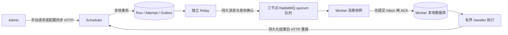

# 可靠任务派发与 RabbitMQ 集群

更新：2026-10-28。已接入远程三节点 RabbitMQ，正常场景及 mq1 停机后各 43 项真实 MQ 三服务检查通过，恢复后队列三个副本全部在线。当前远程 Broker 为 3.8.34，显式使用旧版兼容策略，至少一次死信转移与在途故障窗口仍未验收。实际结果见 [验证记录](mq-verification.md)。

2026-10-28 新增方案 A 水平扩展：MQ 首次派发按能力和负载选择节点，Attempt 绑定目标，Outbox 固定路由；发布重试不改投。结果上报新增 workerId/sessionId，租约失效后可按快照上限新增 Attempt。部署、升级和边界见 [Worker 水平扩展](worker-horizontal-scaling.md)。

## 服务边界与调用链

Admin 保持 Job 权威数据和 HTTP 配置同步 Outbox；Scheduler 拥有 Run/Attempt 和派发 Outbox；Worker 只写自己的 Inbox 和待上报结果。服务不引用彼此 Maven 应用模块，不共享 Entity、Mapper 或数据库。



Scheduler 的 dispatch 包分为 config、dto、model、service/impl、mapper；Worker 的 dispatch 包分为 config、dto、service/impl，复用 execution Service 的数据访问，因此不创建空 Mapper 或 Controller。协议 DTO 由两端各自声明，当前不引入公共业务模块。

## Outbox 状态与事务

Flyway V5 创建 Scheduler 自有 `dispatch_outbox`，每个 Attempt 仅一个事件，eventId 固定等于 attemptId。手动创建、Cron 创建和明确业务失败后的重试，均在写入 Run/Attempt 的同一本地事务中写入 WAITING 发送意图。

| 状态 | 语义 |
| --- | --- |
| WAITING | 持久化意图已提交，尚未到达实际派发准备阶段 |
| READY | 已与 Attempt 租约一起提交不可变消息，可发布或等待退避 |
| SENDING | Relay 已取得带 claimVersion 的有限领取租约 |
| PUBLISHED | 收到 Broker confirm ACK 且未收到 mandatory return |
| FAILED | 有限发布次数耗尽，执行结果未确认 |
| CANCELLED | 未确认事件对应的 Attempt 已终结，或派发租约已过期 |

WAITING 不提前消耗执行租约。派发准备时与 Attempt 的 DISPATCHING、expiresAt 同事务保存完整消息，此后每次重发保持 eventId、内容和 expiresAt 不变。V5 也为升级前 READY/DISPATCHING Attempt 回填意图，不回填已确认运行或终态记录。

Relay 每次领取最多扫描 100 条候选，逐条短事务锁定 Outbox、检查状态并推进 claimVersion。发布及 confirm 等待在事务之外；标记成功/失败必须同时匹配 SENDING、claimVersion 和未过期领取租约。数据库出错留下的 SENDING 在领取租约到期后可接管。

节点或 Handler 不满足派发资格，或最近心跳的 `runningCount + pendingCount >= maxPending` 时，准备阶段推迟 Attempt 的 `next_dispatch_at`，发布阶段推迟 Outbox 的 `next_publish_at`，默认间隔由 `taskflow.dispatch.node-recheck-delay` 控制为 2s（100ms–5m）。扫描按下次时间和记录 ID 稳定排序，仍保留每批 100 条上限。等待不新建 Attempt、不增加派发/发布次数，不新增或延长执行租约。心跳只是负载观察，不是容量预订；已经在途的消息仍需 Worker 本地容量检查。

Outbox 的 READY 和过期 SENDING 都必须到达 `next_publish_at` 才能成为候选。过期 SENDING 延后时保留原 state、claimVersion、claimUntil 和不可变消息；旧 Publisher 仍无法用过期领取租约确认。下一次实际领取才推进 claimVersion 和发布次数。SQL 同时检查状态、版本与到期条件，旧扫描结果不能覆盖已安排的下一次检查、仍有效的新领取或取消状态。等待资格的时间独立于发布失败退避，且不会延长原消息的 expiresAt。验证见 [扫描公平性](dispatch-fairness-verification.md)。

提交前崩溃会回滚；提交后未发送会恢复；Broker 接收后本地未标记会重发原事件。数据库提交、MQ 发布和 Worker 提交是三个独立边界，不能描述成一个原子操作。

发布默认最多 5 次，次数包含领取后进程崩溃导致的未知发送；指数退避从 2 秒至最多 30 秒。最后一次结果未知也不会无限重发或自动创建新业务 Attempt。FAILED 记录保留 lastErrorCode，运行查询最终显示 `MQ_PUBLISH_UNCONFIRMED`；此阶段没有自动死信回放或 Outbox 人工重试 API，人工再次执行应创建新 Run 并先核对未知副作用。

## 消息协议 v1

共享交换机默认 `taskflow.dispatch.v1`。默认节点的 routing key 为 `worker.default`、队列为 `taskflow.worker.default.v1`；其他节点使用各自独立路由和队列，由 Outbox 路由快照决定。AMQP 属性必须包含 `type=taskflow.dispatch.v1`、`message_id=eventId`、JSON 内容类型及持久投递模式。

```json
{
  "version": 1,
  "eventId": "与 command.attemptId 相同的 UUID",
  "command": {
    "attemptId": "UUID",
    "runId": "UUID",
    "attemptNumber": 1,
    "leaseVersion": 1,
    "expiresAt": "UTC ISO 8601",
    "snapshot": "与 HTTP Dispatch 完全相同的配置快照对象"
  }
}
```

上例为字段示意，snapshot 的实际值为对象，定义见 [执行协议](execution-protocol.md)。不把配置后续查询或缓存结果代入已经生成的事件。

Worker 校验协议版本、消息标识、完整 DTO 约束及 128 KiB 消息上限，随后调用本服务 IExecutionService.insert，先提交 Inbox 再手动 ACK。相同 Attempt、相同命令返回原接收记录；不同内容拒绝，不覆盖旧记录。ACK 丢失允许 Broker 重投；去重记录不自动归档。

`429 / WORKER_BUSY` 表示容量背压，不计入 `max-consume-attempts`。Worker 保留当前未确认 delivery，每隔 `consume-retry-delay`（默认 1 秒）复查容量；固定单消费者、prefetch=1，使后续消息留在 Broker，不反复 nack/requeue，不占用 Handler 槽位，也不在等待期间持有数据库事务。容量恢复后接收原消息，先提交原 Attempt 的 Inbox 再 ACK，不新建 Run/Attempt、不修改消息或续租。

等待期间或首次消费时命令已过期：不执行 Handler、不新写 Inbox，直接 ACK 移除失效投递，不因满载或过期进入死信。ACK 仅表示该消息已处理，不是执行成功；Scheduler 持久化的原 Attempt 继续由租约扫描收尾为 `TIMED_OUT / LEASE_EXPIRED`，Run 为 FAILED。已接收命令的重复投递仍优先按 Inbox 幂等确认。关闭连接后由 Broker 恢复未确认消息；等待被中断时保留中断标记并 nack/requeue，供恢复处理。

数据库等实际接收故障仍累计最多 4 次，间隔默认 1 秒；夹杂的容量等待既不增加也不重置这个预算。只重试 Inbox 提交，不重试 ACK，也不在消费线程执行 Handler。无效事件、未知 Handler、冲突内容或实际接收故障预算耗尽仍 reject 且不重新入原队列，用于隔离无法处理的事件；容量满载不走这个分支。Broker 按部署 policy 转至 `taskflow.worker.default.dead.v1`；当前 3.8.34 环境的死信保障仍以上方旧版兼容说明为准。应用日志记录事件 ID 与错误类型，不打印消息参数或密码。

死信转移不直接更新 Scheduler 权威状态；若没有合法结果上报，原 Attempt 按执行租约超时收敛。MQ 确认后的 RUNNING 表示派发已交由 Broker，不代表 Handler 精确开始时间。消息在 Broker 排队也消耗既有执行租约，不进行续租；长时间积压仍可能使任务超时，不能把“不进死信”解释为无限等待或保证执行成功。满载等待与恢复验收见 [容量背压验证](dispatch-backpressure-verification.md)。

Broker 的 delivery acknowledgement timeout 应大于允许的最大在途租约剩余时间并留出数据库 I/O 余量，否则 Broker 可能在等待期间关闭 channel。3.8 环境需按实际版本设置节点级 `consumer_timeout`；较新版本可按队列配置，见 [RabbitMQ 消费确认超时](https://www.rabbitmq.com/docs/consumers#acknowledgement-timeout)。Broker 参数和队列策略由部署环境管理；部署长超时任务前需核对该值。应用背压不会通过主动反复重投制造 delivery-limit 死信，但连接故障和 Broker 自身策略仍属于独立的运维边界。

PUBLISHED → RUNNING 的本地确认与 HTTP 接收确认使用相同的状态保护，不能覆盖已提交的执行终态。状态事务按 Run → Attempt → Outbox 加锁，Attempt 使用当前锁定读取；Relay 仍只锁 Outbox，不反向锁 Run/Attempt。发布确认到达时，若执行结果已提交，则保留该结果，不重复推进状态。数据库并发验收见 [状态并发修复](run-state-concurrency-verification.md)，其中 MQ 测试模拟 Broker 已确认的持久化边界，不代表真实 Broker 故障测试。

## 集群部署

仓库提供 RabbitMQ 4.3.6 management 镜像的三节点 Compose，节点名为 rabbit@rabbit1、rabbit@rabbit2、rabbit@rabbit3，使用 classic_config 自动发现、统一随机 cookie 与独立数据卷。账号/vhost 先引导，等待三个节点在线后才导入三副本 quorum 队列；up 还会 grow 已有队列成员，避免只启动首节点时悄悄成为单副本。

在仓库根目录使用 PowerShell：

```powershell
# 生成本机随机 cookie、分角色密码、Broker 定义及服务 YAML；无需 Docker
.\tools\mq-cluster.ps1 -Action init
# 需要 Docker Compose v2；启动节点、等待集群并配置队列
.\tools\mq-cluster.ps1 -Action up
.\tools\mq-cluster.ps1 -Action status
# 停止容器，保留数据卷
.\tools\mq-cluster.ps1 -Action stop
```

init 不覆盖已有凭据。生成的 infra/rabbitmq/.env、runtime/ 和 config/taskflow-*-mq-local.yml 被忽略，不应提交。若早于当前版本执行过 init，需先核对本地定义是否包含 topology.json，不要对已有持久卷重置账号或 cookie。

| 对象 | 访问/权限 |
| --- | --- |
| 三节点 AMQP | 宿主机 127.0.0.1 的 5672/5673/5674 |
| 三节点管理台 | 宿主机 127.0.0.1 的 15672/15673/15674 |
| taskflow_mq_admin | 管理员；密码在忽略的 .env，不给应用使用 |
| taskflow_scheduler | 仅在 taskflow vhost 发布 taskflow.dispatch.v1，不读队列或配置资源 |
| taskflow_worker | 仅在 taskflow vhost 消费固定 Worker 队列，不发布或配置资源 |

应用使用 Rabbit Java 客户端的多节点地址恢复连接；quorum 副本保障队列数据，两个机制需要同时配置。status 应看到所有节点在线、两个队列 type=quorum，members 和 online 均为三个。一个节点故障仍可由多数派继续服务；失去多数派时不可声称可继续确认写入。副本和确认语义依据 [RabbitMQ quorum 文档](https://www.rabbitmq.com/docs/quorum-queues) 与 [发布/消费确认](https://www.rabbitmq.com/docs/confirms)。

同主机 Compose 用于开发和节点故障演练，不提供主机级容灾。实际跨主机部署需调整节点 DNS、分布式通信网络、持久卷与 AMQP 地址，并配置 TLS 和受限网络。不要直接把当前回环端口映射改成公网暴露。

## 应用参数与切换

### 接入已有外部集群

外部集群不需要在开发机安装 Docker。管理连接保存在被忽略的 `.tools/mq-cluster-settings.json`；从 `infra/rabbitmq/external-cluster.example.json` 复制并填写三个应用地址、三个管理入口、管理员凭据。`serviceCredentials` 可填写本机 `config/taskflow-scheduler-mq-local.yml`、`config/taskflow-worker-mq-local.yml` 中已有的独立角色凭据，供隔离验收使用；删除整个可选字段则沿用原验收脚本的管理员连接方式。不要将实际地址和密码写进受版本管理的模板。

```powershell
# 只在没有本机角色凭据时执行 init；已有文件会被保留并拒绝覆盖
.\tools\mq-cluster.ps1 -Action init
New-Item -ItemType Directory .tools -Force | Out-Null
Copy-Item infra/rabbitmq/external-cluster.example.json .tools/mq-cluster-settings.json
# 编辑设置后，向尚无 taskflow vhost 的集群导入本机已有角色和三副本资源
.\tools\connect-mq.ps1 -ClusterSettingsPath .tools/mq-cluster-settings.json
```

`connect-mq` 要求三个节点在线，拒绝覆盖已有 `taskflow` vhost、同名角色或共享连接 YAML。该命令导入本机 init 生成的 definitions/topology，不改变现有节点、cookie、卷或网络，也不自动重试管理写请求。导入后检查两个队列的三个在线副本，再保存 `config/taskflow-mq-cluster-local.yml`，由 Scheduler/Worker 在各自角色 YAML 之后读取。共享文件仅覆盖连接地址、vhost、transport 和 Rabbit 健康检查，各服务仍使用自己的账号；重启服务后生效。

RabbitMQ 3.8/3.9 必须显式添加 `-AllowLegacyBroker`。兼容模式使用这两个版本支持的队列策略，不配置 `dead-letter-strategy=at-least-once`；死信转移仍是 at-most-once，目标不可用时可能丢失死信。至少一次死信转移从 RabbitMQ 3.10 才引入，不能把旧版兼容验收等同于仓库 4.x 的完整可靠死信保障，依据 [RabbitMQ 官方说明](https://www.rabbitmq.com/blog/2022/03/29/at-least-once-dead-lettering)。默认不允许静默降低该保障，也不会自动升级现有 Broker。

外部集群使用以下验收命令；3.8/3.9 同样添加 `-AllowLegacyBroker`：

```powershell
.\tools\test-mq.ps1 -ClusterSettingsPath .tools/mq-cluster-settings.json -ManualFailover -SkipBuild -SkipBrowser
```

三节点闭环通过后，脚本提示停止第一个管理入口对应的节点。操作人员在服务器终端停止指定容器，再返回验收终端按回车；脚本从第二个管理入口确认同一组队列保留三个成员、只有两个副本在线，再使用全部应用地址重跑闭环。随后按提示恢复节点，确认两个队列都恢复为三个在线副本。外部模式不保存 SSH 凭据，也不从设置文件执行任意命令；失败后的 finally 同样提示恢复节点。`-SkipFailover` 只验证三节点正常场景，报告会标明未测故障。

证据在 `.tools/mq-e2e/<随机测试vhost>/`：`report.json` 记录版本、兼容模式、故障节点和各阶段检查数及执行证据目录；`quorum-before.json`、`quorum-one-node-down.json`、`quorum-restored.json` 保存队列成员和在线副本；阶段日志与三服务报告分别保留。每阶段使用独立 H2，沿用同一个随机 vhost；成功只删除该测试 vhost，保留业务 `taskflow` 资源。

所有连接和重试参数在服务 application.yml，测试使用独立 YAML profile；Java 不硬编码连接地址或凭据。

| 环境变量 | 含义 |
| --- | --- |
| TASKFLOW_DISPATCH_TRANSPORT | rabbitmq（默认）或 http；无自动 HTTP 降级或双发 |
| TASKFLOW_MQ_ADDRESSES | 逗号分隔的三个 AMQP 节点地址；TLS 可用 Spring rabbitmq SSL 配置 |
| TASKFLOW_MQ_VHOST | 默认 taskflow |
| TASKFLOW_MQ_USERNAME / PASSWORD | 每个进程使用各自角色凭据；默认密码为空 |
| TASKFLOW_MQ_EXCHANGE / QUEUE / ROUTING_KEY | 共享 exchange；Worker queue/routingKey 独立，Scheduler 将所选节点路由持久化到 Outbox |
| TASKFLOW_MQ_DLX / DLQ / DEAD_ROUTING_KEY | 死信资源名称，Broker 定义需同时配置 |

默认 confirm 等待 5 秒、领取租约 30 秒；AMQP 连接超时 3 秒、heartbeat 15 秒。Broker confirm/return 检查遵循 [Spring AMQP 官方说明](https://docs.spring.io/spring-amqp/reference/amqp/template.html)。声明的死信参数用于部署契约，应用账号不自行创建 Broker 资源，需通过集群定义或部署系统配置。

升级：暂停所有节点的 Cron 触发并阻止新手动请求，等待旧 HTTP 派发和执行终结；先部署/检查 MQ 三副本资源，再升级 Scheduler 应用 V5 和 Worker、同步切换 transport，确认查询及执行后恢复触发。变更队列名、Worker 身份、数据库或从 MQ 回退 HTTP 同样需要先排空在途工作。不要在两个模式或多个 Worker 身份之间并发投递同一 Attempt。

MQ 未部署时可显式用 http，并设置 `TASKFLOW_MQ_HEALTH_ENABLED=false`；未使用共享连接 YAML 的环境也可在 Scheduler 和 Worker 本机 YAML 设置 `management.health.rabbit.enabled: false`。默认测试 profile 已配置此项，不需要 Broker。运行实例是否部署新代码、MQ 是否真实可用与源代码完成度分别验收。

每条工作队列对应一个 Worker 身份、一个执行进程及其持久化 Inbox。带不同 Inbox 的 Worker 不竞争同一队列。Scheduler 为新 Attempt 按能力/负载选择节点，保存目标和 Outbox 路由，Relay 重发不改投；租约失效按快照上限新增 Attempt 后可选择其他节点。执行有界续租已实现，MQ 三副本与 Worker 多进程是两个独立层次；不提供同一 Attempt 跨 Inbox 接管，外部副作用仍需业务幂等。部署见 [水平扩展](worker-horizontal-scaling.md)。

## 验收

```powershell
.\mvnw.cmd verify
# 独立三进程、隔离文件 H2，复测真实 Cron；默认显式 HTTP
.\tools\test-execution.ps1 -SkipBuild -SkipBrowser
# 集群就绪后：随机隔离 vhost、真实 MQ 闭环、重复事件、单节点停机后重跑
.\tools\test-mq.ps1 -SkipBuild -SkipBrowser
```

test-mq 默认只对本仓库 Compose 的 rabbit1 做停机并在 finally 恢复，不删除数据卷；外部集群按上文使用人工停止/恢复步骤。测试成功仅删除脚本创建的 taskflow_it_ 随机 vhost，失败保留证据，不会清空 taskflow 业务 vhost。真实 MQ 测试不应使用业务队列或业务数据库。多数派丢失、网络分区与跨主机持久化恢复尚需额外环境演练，不能由 Mock 的 confirm 代替。
