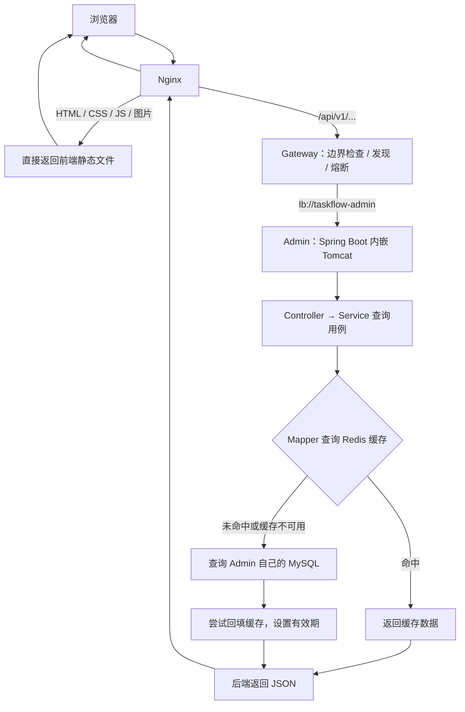

# TaskFlow 浏览器访问与缓存流程

## 用户确认的目标链路

**浏览器 → Nginx（静态直返 / API 转发）→ Gateway（WebFlux/Netty）→ Admin Tomcat → Redis（缓存命中则返回）→ 数据库（未命中时查询并回填缓存）→ 逐层返回。**

这条链路已用于管理控制台的任务详情查询。静态请求和动态请求分支处理；Redis 和数据库由后端业务代码调用，Redis 不会自行转发 SQL 到数据库。分页和统计仍直接查数据库。



## 各层职责

| 层 | 负责什么 | TaskFlow 中的对应位置 |
| --- | --- | --- |
| 浏览器 | 展示界面、校验输入、发起同源 API 请求 | taskflow-web |
| Nginx | 返回构建后的静态文件；把 /api/ 请求转发给 Gateway | deploy/nginx 与部署包 |
| Gateway | JWT 校验、用户分组限流、公开路由、服务发现、熔断和追踪 | taskflow-gateway；仅访问自己的 Redis 限流键，不访问业务数据库或 Admin 缓存 |
| Tomcat | 接收 HTTP 请求，将请求交给 Spring MVC | taskflow-admin 内嵌容器，无需另装独立 Tomcat |
| 业务代码 | 校验、权限、业务规则、事务、缓存与数据库调用编排 | controller → service 接口 → service/impl → mapper |
| Redis | 可丢弃、可过期的查询缓存，降低重复数据库读取 | job/mapper/redis 的 Admin 独立缓存实现 |
| MySQL | 保存任务配置、版本等权威数据 | taskflow_admin schema |

## 查询流程：先缓存，未命中再查库

以 GET /api/v1/jobs/selectById?id=123 为例：

1. 浏览器通过独立 Keycloak 登录后携带 Bearer JWT 请求 Nginx；Nginx 做 IP 粗限流，保留路径转发 Gateway。Gateway 检查公开路径、验证 JWT，按用户及业务分组检查限流 Redis，再通过 LoadBalancer 选择 Admin。
2. Admin 独立验签，在本服务 Redis 核对缓存 JWT 会话并将 TTL 续期为 30 分钟，然后检查权限。通过后由 Controller 校验入参并调用业务用例；超时返回 401 并由前端显示登录页。具体边界见 [登录与入口安全](access-security.md)。
3. JobQueryController 调用 IJobDetailService，其实现 JobDetailServiceImpl 通过 JobCacheMapper 读取 Redis，默认 key 为 taskflow:admin:job:detail:v1:123。
4. 命中且内容有效：返回缓存 DTO，无需本次数据库查询。
5. 未命中：记录查询开始时间，调用 IJobService / JobServiceImpl 的数据库详情查询，经 JobDataMapper 访问 MySQL。只读事务结束后，通过 JobCacheMapper 将任务快照和绝对过期时间序列化成 JSON 回填 Redis，默认 TTL 为 60 秒；随后返回 JSON。回填只使用从查询开始计算的剩余 TTL，超过有效期的慢查询不再回填。不缓存不存在的任务。
6. Redis 读取超时或回填失败：有限超时后回退数据库或直接返回已经查到的数据，不因缓存回填失败丢弃正常查询结果。
7. 数据经 Tomcat、Gateway、Nginx 返回浏览器，由前端更新页面。

初期只缓存任务详情这一种查询。分页列表和统计先直接查数据库，避免在未明确失效范围时缓存所有查询。接口响应格式和 /select 等动作路径保持现有约定。

## 写入流程与一致性边界

新增、修改、启用、停用、删除均通过业务用例写 MySQL；数据库是权威来源。涉及已有任务的操作继续校验 configVersion。

```text
浏览器 → Nginx → Gateway → Admin Tomcat → 校验和业务用例
                         → MySQL 本地事务提交
                         → 尝试删除对应 Redis 详情缓存
                         → 返回业务结果
```

写用例发布 JobDefinitionChanged，Redis 适配使用 AFTER_COMMIT 事务监听器删除缓存；回滚时不执行删除。数据库事务和 Redis 操作不构成同一个原子事务。删除失败记录告警并立即有限重试，默认包含首次最多三次；全部失败后记录错误，不把已提交的写入返回为失败，依靠 TTL 淘汰旧数据。本阶段没有持久化补偿队列；提交后进程崩溃丢失通知的情况也依靠 TTL 恢复。

IJobService / JobServiceImpl 的详情读取保留为数据库读取，修改、启停、删除和写操作的响应始终使用它。页面详情单独走 IJobDetailService / JobDetailServiceImpl；若它被其他本地事务调用，则跳过缓存，避免缓存未提交的数据。未来执行派发也必须读取权威数据并检查版本。

并发旧查询仍可能在写入失效后回填旧快照；失效失败时也可能读到旧版本或刚删除的任务。允许旧缓存存在至原数据库查询开始后 60 秒（可配置），不会因延迟回填重新续满 TTL；读取时同时校验 JSON 内的绝对过期时间，以覆盖 Redis 命令排队延迟。多实例需保持时钟同步；这个期限不限制已经在途请求的总耗时。该方案不提供强一致性。

## 微服务边界

- Redis 缓存属于各服务自己的数据适配；不作为三个服务共享的业务状态库。
- Admin 缓存 Job 展示数据；Scheduler 的 Run/Attempt 和调度状态仍由 Scheduler 自己管理。
- Worker 不通过 Redis 或 SQL 读取其他服务的数据，继续通过版本化协议协作。
- 即便开发环境共用一个 Redis 实例，也使用服务前缀和独立访问配置；缓存 key 的命名不等于访问权限隔离。
- 浏览器不直接连接 Redis 或 MySQL；Nginx 不承载任务业务和缓存一致性逻辑。

## 当前实现与验收

Admin 任务详情缓存、TTL、写后失效和故障降级已实现；重新启动 Admin 后默认启用。引入 Gateway 后，前端路径与 JSON 协议保持不变，但 Nginx 上游需更新为 8088 并启动 Gateway。cloud 模式需要 Eureka/Config Server；详情见 [平台配置](microservice-platform.md)。Redis 配置见 [Redis 文档](redis.md)。

验收覆盖首次查询未命中并回填、再次命中、TTL 到期重查、修改/启停/删除后的失效、事务回滚、版本冲突、缓存故障降级、删除重试耗尽和并发旧快照回填。默认测试使用 H2 和模拟 Redis；真实 Redis 测试使用随机独立前缀，仅操作测试自己创建的精确 key，不扫描或清空已有数据。实际验证结果见 [缓存验证记录](cache-verification.md)。

## 配置异步同步

Job 写入在 Admin 同一本地事务中保存配置与 Outbox，提交后继续使详情缓存失效。独立后台线程领取事件，在数据库事务外调用 Scheduler；保存接口不等待远程同步。同步状态查询直接读 Admin 数据库，不进入 Redis 详情缓存，因此确认结果不会等待详情缓存 TTL 才可见。Scheduler 只写本服务计划副本与 Inbox，Worker 不参与配置同步。协议与失败边界见 [配置同步](config-sync.md)。

## 参考

- [Redis Cache-Aside 模式](https://redis.io/docs/latest/develop/use-cases/cache-aside/)
- [Spring Boot Servlet Web 应用](https://docs.spring.io/spring-boot/reference/web/servlet.html)
